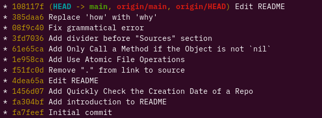
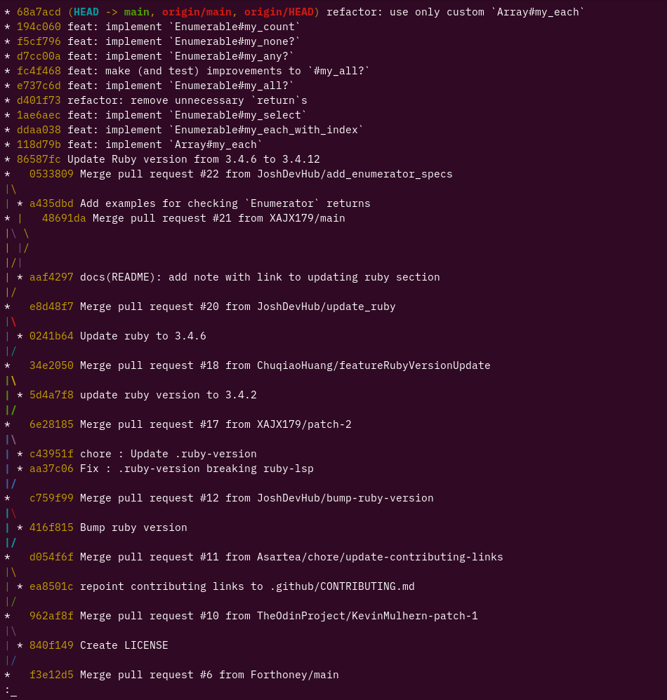

# Get a Neat View of a Repo's Commit History

Discovered this while checking out [Hashrocket's TIL](https://til.hashrocket.com/). So cool!

```bash
git log --oneline --graph --decorate --all
```

### Sample output

For [this very repo](https://github.com/42natus/til/tree/108117fd90fb6da5a3f3c3db0b79767a9a26dcb3), this gives the output:



On a repo with a more...colorful commit history, it looks something like this:



(The commit history in last image was gotten from my fork of **The Odin Project**'s `custom_enumerable_project` repo)

---

### Sources

- https://til.hashrocket.com/posts/pfjzwvr00o-visualize-a-git-branchs-history
